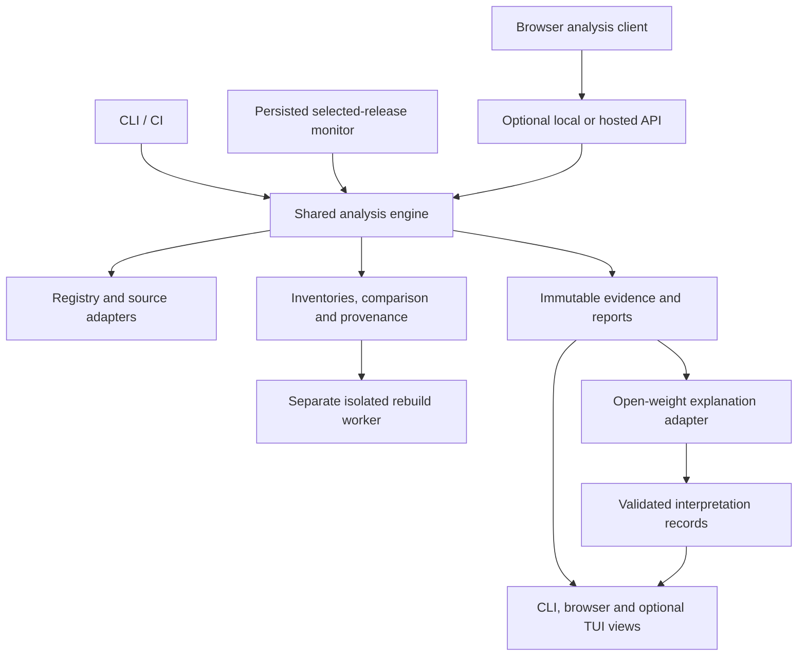

# Heurisko

**Investigate how a published software package relates to its claimed source, explain the differences, and keep the evidence inspectable.**

Heurisko is a software supply-chain integrity project for **Problem 04 — Published Package vs Source Code Integrity Analyzer** at Hacktoberfest 2026 Hack Day Sonipat. It asks a precise question:

> Does this exact published artifact correspond to the claimed source revision, what explains the differences, and what remains unresolved?

Developers often review a Git repository but install a tarball or wheel from a package registry. Those inputs can differ because of compilation, bundling, packaging rules, generated metadata, native code, or unauthorized changes. Heurisko's proposed role is to investigate that relationship and show the evidence behind each explanation and suspicious finding.

**Current status — 31 October 2026:** this repository contains the hackathon declaration, organizer documents, and a completed research/design dossier. **No analysis engine, CLI, TUI, web application, release monitor, model integration, or product tests have been implemented.** The architecture and product decisions below are proposals, not approved commitments or working features. There is no runnable installation yet.

Team **InBuildingPhase**: **Shane Joseph** and **Malhar Mahanor**. See [HACKATHON.md](HACKATHON.md) for the original declaration and [AGENTS.md](AGENTS.md) for contributor instructions and approval boundaries.

## Contents

- [The problem and intended contribution](#the-problem-and-intended-contribution)
- [Scope and user workflows](#scope-and-user-workflows)
- [How an investigation would work](#how-an-investigation-would-work)
- [Evidence and report semantics](#evidence-and-report-semantics)
- [System architecture](#system-architecture)
- [Terminal and browser experience](#terminal-and-browser-experience)
- [Open-weight AI](#open-weight-ai)
- [Release monitoring](#release-monitoring)
- [Security and execution boundaries](#security-and-execution-boundaries)
- [Reuse and differentiation](#reuse-and-differentiation)
- [Verification and demonstration](#verification-and-demonstration)
- [Implementation roadmap](#implementation-roadmap)
- [Installation and execution](#installation-and-execution)
- [Repository and research guide](#repository-and-research-guide)
- [Hackathon rules and contribution workflow](#hackathon-rules-and-contribution-workflow)
- [Open decisions and limitations](#open-decisions-and-limitations)
- [License](#license)

## The problem and intended contribution

A source checkout and a published package are different objects. For example, a repository may contain TypeScript, tests, and build configuration while its npm release contains JavaScript bundles and declarations. A Python release can contain an sdist and several wheels with different platform-specific contents. Comparing their paths alone produces differences without establishing whether those differences are expected.

The harder task is finding the right immutable source revision and package subdirectory, reconstructing the relevant build context, and accounting for the content that remains unexplained. A version-shaped Git tag, repository URL, source map, or generated-looking filename is a clue. Each needs corroboration before it supports a stronger claim.

Heurisko's proposed contribution combines:

- Exact artifact identity and explicit source-candidate resolution.
- Raw comparisons followed by narrowly scoped packaging and build explanations.
- Provenance verification and optional independently checked rebuild evidence.
- File-level findings with retrievable evidence, confidence, severity, and limitations.
- One report contract shared by terminal, browser, CI, and release monitoring.
- Open-weight model explanations that remain separate from verified observations.

This is an investigation tool, not a universal safety certificate. A package can match malicious source. A valid signature can authenticate an unsafe release. A failed rebuild can reflect environment drift or nondeterminism. Missing provenance or unexplained content deserves investigation without establishing malicious intent.

The [research baseline](docs/Heurisko_Research/HEURISKO_RESEARCH_BASELINE.md) explains the packaging, provenance, incident, and threat-model foundations. Existing tools already cover substantial parts of this field; Heurisko's distinct value remains a hypothesis to evaluate.

## Scope and user workflows

The organizer's complete P04 scope has eight capabilities:

| Required capability | Intended Heurisko behavior |
|---|---|
| Retrieve published packages from npm **or** PyPI | Acquire a precisely selected registry artifact and retain expected and observed digests. |
| Identify and retrieve corresponding source | Resolve a repository, immutable commit, and package subdirectory with evidence and explicit ambiguity. |
| Compare source and distributed contents | Preserve raw inventories, hashes, file differences, and comparison scope. |
| Identify generated files and normal build artifacts | Explain transformations using configuration, mappings, toolchain details, or rebuild evidence. |
| Detect unexpected or suspicious modifications | Locate unsupported executable additions, manifest/script changes, and other unexplained differences. |
| Explain individual differences | Attach a supported explanation or an explicit unresolved disposition. |
| Provide an evidence-supported risk assessment | Present findings, potential impact, evidence confidence, and limitations. |
| Monitor selected packages' new releases | Persist discovery state and analyze newly observed artifacts through the same engine. |

**npm-first is the proposed delivery sequence.** PyPI is the next ecosystem expansion and a design check for artifact-specific identity. Shipping both registries simultaneously is not an organizer requirement. Basic monitoring is required; a hosted monitoring dashboard is optional. All capabilities remain unimplemented.

The proposed workflows serve several users:

| User and trigger | Investigation and useful outcome |
|---|---|
| Developer adding a dependency | Analyze a pinned release before a separate installation; inspect source association and unexplained content. |
| Maintainer validating a release | Compare the published artifact with the intended commit and build recipe; investigate packaging mistakes or unexpected output. |
| Security engineer investigating a release | Follow exact changed paths and evidence, optionally request an isolated rebuild, and export an inspectable report. |
| Developer reviewing an upgrade | Compare old and new artifact reports, keeping release-to-release changes distinct from source-to-artifact differences. |
| Team auditing a project | Resolve supported lockfile entries to exact direct/transitive artifacts, deduplicate work, and retain unsupported dependency forms as unknown. |
| User monitoring selected packages | Discover new artifacts, run bounded investigations, and inspect pending, failed, stale, and completed outcomes. |

Project audits, upgrade comparison, SARIF, and the TUI are enhancements after reliable single-artifact analysis. Hosted investigations, accounts, collaboration, and notifications are later platform options. The initial direction excludes automatic dependency repair, vulnerability reachability analysis, private hosted package analysis, and arbitrary semantic-equivalence claims. The product is complementary to advisory and malware scanners.

## How an investigation would work

The following pipeline is proposed. It describes the intended engine rather than completed behavior.

1. **Resolve the exact input.** Record ecosystem, normalized package name, version, registry origin, artifact filename, and digest. Resolve a floating selector once and preserve the result. Treat a locally supplied archive as `local-input`, even if its filename and manifest copy a genuine release.
2. **Capture registry evidence and acquire bytes.** Retain metadata, origin, observation time, expected digest, and observed digest. Fetch the archive directly without installing the target package or running its scripts. A digest conflict stays visible.
3. **Inventory the artifact safely.** Record original and canonical paths, file types, content hashes, sizes, and parsing outcomes. Unsafe entries block safe processing; oversized, unsupported, or skipped content remains in the coverage accounting.
4. **Resolve source candidates.** Examine artifact-bound attestations, repository metadata, commit claims, release tags, manifests, and content corroboration. Pin a full commit and monorepo subdirectory when justified. Preserve contradictory or missing evidence rather than substituting the current default branch.
5. **Verify available provenance.** Check the exact subject digest, signature, predicate, signing identity, trust roots, and expected repository/builder policy through established verifier tooling. Distinguish a publishing assertion from a source/build assertion.
6. **Compare in layers.** Begin with raw bytes and inventories. Add named, versioned packaging normalizations, structural analysis, and source-map correspondence. Each layer adds evidence while retaining the original mismatches.
7. **Strengthen explanations where possible.** Reuse verified external rebuild evidence or run a declared recipe in a separate isolated worker. Distinguish an exact archive match, matching extracted content, and normalization-qualified agreement.
8. **Retain findings and residuals.** Link observations to exact artifact/source paths, hashes, and ranges. Every analyzed difference has a disposition; an unexplained executable region cannot disappear behind a generated-file label.
9. **Request a grounded model explanation.** Supply bounded evidence excerpts and stable IDs. Validate references and quotations. Store supported explanations, hypotheses, abstentions, and rejected claims separately from deterministic findings.
10. **Write an immutable report.** Atomically preserve the report and evidence manifest. CLI, web, TUI, and CI consume the same facts. Changed inputs, rules, or policy produce a new report linked to the earlier one.

### Why build-aware comparison is difficult

| Difference | Supporting evidence to seek | Remaining limit |
|---|---|---|
| Tests or documentation omitted | Package inclusion rules, ignore files, and computed file selection | A rule describes intended packaging; it does not prove that every omission is appropriate. |
| TypeScript replaced by JavaScript or bundles | Exact source/configuration, toolchain, validated mappings, and a controlled rebuild | A `dist/` path or source map alone does not establish origin or harmlessness. |
| Generated metadata, declarations, or version files | Applicable format rules and the originating build step | Generated fields can still alter behavior or package identity. |
| Native libraries in a wheel | Platform-specific recipe, inputs, and binary/rebuild comparison | One worker may not reproduce every architecture, ABI, or toolchain. |
| Different archive bytes with identical members | Separate archive and member hashes, metadata/order/compression comparison | Content agreement is distinct from byte-identical archives. |
| Added lifecycle script or executable | Exact manifest delta, referenced code, and any supporting build explanation | Installation hooks can be legitimate; novelty alone does not establish intent. |
| Minified or obfuscated release-only content | Structural deltas, mapped/unmapped regions, and reproducible build evidence | Minification is common; similarity cannot prove general semantic equivalence. |

No package-name allowlist or broad normalization should silently convert a residual difference into an explanation. Raw differences remain inspectable.

## Evidence and report semantics

The proposed report separates five dimensions. These are design enums, not output from an executed analysis.

| Dimension | Proposed states | Meaning |
|---|---|---|
| Artifact identity | `registry-digest-match`, `local-input`, `conflict`, `unknown` | Which exact bytes were analyzed and how they relate to the registry expectation. |
| Source identity | `attested`, `corroborated`, `candidate`, `ambiguous`, `missing` | Strength and uncertainty of the exact repository/commit/subdirectory association. |
| Provenance | `verified`, `invalid`, `absent`, `unsupported`, `not-checked` | Verification outcome, with predicate details and a separate `policyAccepted` result. |
| Comparison | `byte-identical`, `normalized-equivalent`, `rebuild-matched`, `partially-explained`, `unexplained`, `not-comparable` | A summary over retained method-specific comparisons and their scope. |
| Completeness | `complete-for-declared-scope`, `partial`, `failed` | Processing coverage and stage outcomes, including skipped files, unsupported formats, and failures. |

`attested` requires verified, policy-accepted evidence that actually binds the selected artifact to the claimed source. A PyPI publish-only attestation does not automatically establish that relationship. `complete-for-declared-scope` can include unresolved findings; it describes completed processing, not a favorable security result.

Each finding should include a stable ID, category, affected locations, evidence IDs, deterministic method/version, reason, severity, confidence basis, limitations, and a useful next review action. **Severity describes potential impact; confidence describes the support for a specific observation. Neither is a package-safety percentage.**

The full proposed contract includes `ArtifactSubject`, `SourceCandidate`, `EvidenceObject`, `FileRecord`, `ComparisonRun`, `ProvenanceResult`, `Finding`, `Interpretation`, `AnalysisReport`, and `MonitorState`. JSON Schema is the proposed language-neutral contract. Schema, engine, rule, transform, trust-policy, and model/prompt versions are recorded independently.

Evidence bundles should preserve acquisition metadata, artifact/source identities, provenance material and trust policy, raw and normalized comparisons, build inputs/results, model metadata, exclusions, and errors. Retaining raw bytes depends on redistribution rights. Replaying a bundle must expose its observation time and cached trust assumptions.

## System architecture

**Proposed design:** one local-first analysis engine with registry and evidence adapters, one versioned report contract, and several interfaces. This diagram describes responsibilities, not a fleet of independently deployed services.



| Component | Responsibility and boundary |
|---|---|
| Shared engine | Orchestrate stages, evidence, findings, cancellation, and coverage. Interfaces do not implement separate verdict rules. |
| Registry/source adapters | Resolve exact artifacts, enumerate releases, capture metadata, and identify source candidates without executing target code. |
| Parser/comparison workers | Perform bounded inventories, manifest and syntax analysis, declared transformations, and file correspondence. |
| Provenance/rebuild adapters | Retain native tool results, exact subject binding, versions, verification policy, and completion/error states. |
| Evidence store | Keep immutable blobs and reports separate from mutable jobs and monitoring checkpoints. |
| Model adapter | Interpret selected evidence without tools, credentials, or authority over deterministic status. |
| Policy evaluator | Evaluate explicit CI rules over findings and completeness, preserving missing-evidence outcomes. |
| Interfaces | Select inputs and render the common report with escaped content and visible uncertainty. |

The research prefers **TypeScript/Node for the engine and CLI, React/TypeScript for the browser, optional Ink for the TUI, JSON Schema contracts, and SQLite plus content-addressed local storage**. A monorepo would keep schema and interface changes reviewable together. These choices are unapproved and untested. **Go with Bubble Tea** is the strongest alternative when standalone binary distribution takes priority; Rust/Ratatui and Python/Textual are also assessed in the dossier.

Normal local analysis and exported-report viewing should not require an account or hosted backend. Fresh registry/source evidence still requires network access unless already cached. An optional API can expose the same engine; heavy analysis and rebuilds need suitable isolated job workers rather than assumptions about serverless duration or filesystem limits.

Caches should bind derived results to exact input digests, source/build context, tool/rule/transform versions, and trust policy. A changed model creates a new interpretation without changing recorded hashes. Deterministic equivalence checks exclude volatile timestamps and generated model prose while retaining both as run metadata.

Separate bounded queues are proposed for downloads, parsing, inference, and rebuilds, with cancellation and backpressure. Resource exhaustion produces a visible partial result. Latency, memory, storage, and operating costs need measurement before choosing numeric budgets or hosted infrastructure.

## Terminal and browser experience

The CLI is proposed as the primary installable and scriptable entry point. The optional TUI, inspired by terminal investigation tools such as Lazygit, would navigate reports rather than implement another analyzer. The browser would provide room for artifact/source trees, side-by-side differences, provenance details, transformation links, and stable evidence references alongside installation and usage documentation.

The following command shapes are **illustrative design proposals only**. The `heurisko` executable does not exist in this repository.

```text
heurisko analyze npm:@scope/name@1.2.3 --format json
heurisko analyze pypi:distribution@1.2.3 --artifact <exact-wheel-or-sdist>
heurisko analyze --artifact <local-archive> --source <repo>@<full-commit>
heurisko inspect <report>
heurisko compare <old-report> <new-report>
heurisko project --lockfile <supported-lockfile>
heurisko watch add npm:package
heurisko watch run --once
heurisko watch status
heurisko watch remove npm:package
heurisko report export <report> --format json|sarif|html
heurisko serve --local <report>
```

Registry-qualified inputs avoid name collisions. A PyPI version with multiple distributions needs an exact artifact or an explicitly recorded selection policy; checking one wheel does not check every wheel.

Human output should lead with artifact identity, source association, findings, and incomplete stages. Machine mode should emit one versioned JSON document on stdout and progress on stderr. Distinct process outcomes are proposed for policy pass, policy violation, incomplete analysis, and invocation/internal error; numeric exit codes remain undecided. SARIF would project actionable findings while full JSON retains provenance and coverage.

The viewer should distinguish byte matches, rebuilt transformations, source-map claims, and model hypotheses. It should keep raw differences available, support keyboard navigation and accessible labels, and handle large lists/diffs without hiding skipped content. An optional loopback API needs a per-session token and origin checks. Exported reports should remain inert; package HTML, SVG, Markdown, or scripts must never become trusted application content.

The initial pre-install workflow is **analyze, review, then separately install a pinned target**. An installer wrapper is deferred: any future claim about installed bytes must bind the actual installation and dependency resolution to the analyzed digest set.

## Open-weight AI

The intended AI task is to explain a bounded difficult difference, suggest plausible transformations, identify missing evidence, and help prioritize investigation. Hashing, source selection, signature verification, comparison results, and completeness remain deterministic responsibilities.

| Model reference | Current status |
|---|---|
| Qwen2.5-Coder-7B-Instruct, proposed Ollama tag `qwen2.5-coder:7b` | Original candidate recorded in `HACKATHON.md`; never integrated or tested. |
| Qwen3-8B and Qwen3-4B | Later research recommends benchmarking these candidates on the same grounded-explanation cases. Neither has been selected through experiments. |
| Other open-weight alternatives and runtimes | Assessed in the product dossier; selection depends on license, actual availability, hardware, and measured explanation quality. |

**Models currently integrated: none.** The later Qwen3 recommendation does not silently replace the original declaration or establish actual model use. Exact weights/digest, quantization, runtime, context limits, prompt/schema version, decoding settings, latency, and memory behavior remain to be validated.

Proposed inference flow:

1. Select bounded evidence excerpts with stable IDs and record omitted scope.
2. Present source and metadata as untrusted data to a model with no shell, network, write, build, or installation tools.
3. Require structured explanations, cited IDs, alternative hypotheses, missing evidence, and abstention reasons.
4. Reject unknown references, fabricated locations/quotes, invalid output, and claims of verification that never happened. Check whether real cited evidence supports the explanation; reference existence alone is insufficient.
5. Store interpretations separately. A model hypothesis needs an independent deterministic check before becoming verified evidence.

On timeout, unavailable weights, invalid output, or insufficient evidence, preserve the deterministic report and mark inference unavailable or rejected. There is no closed-model fallback in the proposed product architecture. Actual open-model inference is still necessary to satisfy the event's meaningful-AI requirement.

P04 permits local inference or a confirmed organizer open-model server. **The Gemma-only, laptop-only restrictions apply to P08, not Heurisko's P04 entry.** Development coding assistants have separate PR disclosure requirements from models embedded in the product.

## Release monitoring

The proposed monitor persists explicitly selected package identities, successful metadata observations, known artifact digests, pending jobs, retries, completed reports, and stopped/stale state. It invokes the ordinary engine for every newly observed selected artifact.

A new artifact can be a new version or a new wheel uploaded to an existing PyPI version. Removed/yanked files and conflicting digest claims are separate events, not automatic malware verdicts. Jobs should be idempotent by artifact and analysis configuration; checkpoints must preserve pending work across crashes without discarding older releases when a newer one appears.

The monitor should expose last successful fetch, last completed analysis, queue backlog, failed polls/jobs, and freshness. It should respect cache validators, rate-limit responses, and retry hints. A local process, scheduler, or CI job monitors only while it runs. A hosted service, notifications, accounts, and a dashboard need separate operational decisions.

## Security and execution boundaries

Heurisko will inspect adversarial inputs. Its proposed default path retrieves and parses evidence without executing package code.

- **Static acquisition:** no target installation, lifecycle hooks, repository hooks, module imports, project plugins, or build-system metadata execution. Commands such as packing or source-building belong outside this path when they can execute target code.
- **Archive handling:** prefer virtual inventories; otherwise use fresh private workspaces. Reject traversal, absolute paths, escaping links, devices, duplicate/colliding paths, and unsupported entry types. Enforce actual emitted-byte, entry-count, nesting, memory, CPU, and time limits.
- **Source and network retrieval:** pin immutable source, control Git configuration/transports, and account for submodules and LFS. Revalidate redirects and destinations to prevent SSRF, including private, loopback, link-local, and metadata endpoints.
- **Untrusted rebuilds:** use disposable restricted Linux sandboxes or VMs with no host credentials, home directory, SSH agent, Docker socket, or writable project mounts. Stage pinned dependencies separately and build offline where feasible. Bound all resources and kill the entire job on cancellation or timeout.
- **No host fallback:** a missing or failing sandbox produces an unavailable/partial rebuild result. A plain container is not a complete hostile-execution boundary; Linux sandbox tools are not presumed to run natively on macOS.
- **Model and rendering isolation:** give the explanation model no action authority; treat source, filenames, logs, and model output as untrusted text. Escape browser content and terminal control sequences.
- **Data and publication:** the event uses public data only. Public availability does not automatically grant redistribution rights. Never publish tampered packages or automated issues/comments on real projects. Hosted retention, sharing, deletion, access, and quotas remain undecided.

These are required design boundaries for future work, **not demonstrated security properties of an implementation**. The [verification strategy](docs/Heurisko_Research/HEURISKO_VERIFICATION_STRATEGY.md) specifies containment and adversarial tests.

## Reuse and differentiation

Heurisko should own investigation orchestration, artifact/source relationship accounting, report semantics, and evidence presentation while integrating established specialist tools where appropriate.

| Tool or category | Proposed relationship |
|---|---|
| OSS Rebuild | Optional existing rebuild/attestation evidence, accepted only after exact-subject verification under a declared trust policy. Coverage and verification access must be checked. |
| vlt reproduce | npm reproducibility baseline and possible isolated-worker integration; its install/pack strategy cannot run in the normal static path. |
| diffoscope | Optional bounded deep archive/binary diagnostics; not source discovery or a maliciousness verdict. |
| Sigstore and pypi-attestations | Reuse signature/attestation verification with expected identity, predicate semantics, and digest binding. |
| Drydock | Compare artifact-review UX and existing diff capabilities; measure whether source-relationship investigation adds value. |
| GuardDog, OSV, Scorecard, Socket, Snyk | Potential complementary behavior, advisory, or repository context, separate from source correspondence. Hosted services are not mandatory engine dependencies. |
| Dependabot and Renovate | Future CI boundaries for analyzing the exact releases proposed by update tools. |

All integrations are research proposals. Exact released versions, licenses/notices, API stability, runtime compatibility, and resource behavior require admission checks. No dependency is installed or integrated. Heurisko does not claim to be the first package-diff tool, rebuild service, or browser artifact explorer. See [tooling and reuse](docs/Heurisko_Research/HEURISKO_TOOLING_AND_REUSE.md) for the full comparison.

## Verification and demonstration

**No product tests, rebuilds, detector benchmarks, or model inference have run.** Research defines a falsifiable validation plan with four separately labeled corpus strata:

| Corpus stratum | What it can establish |
|---|---|
| Exact real public releases and reviewed source associations | Behavior on genuine packaging/build differences, with independently reviewed evidence. |
| Controlled benign transformations | Known source/build/output relationships for compilation, bundling, metadata, and packaging. |
| Controlled local tampering | Detection and localization of recorded inert mutations against an independently hashed baseline. |
| Uncertainty and failure cases | Correct abstention and partial accounting for missing source, invalid/unsupported provenance, malformed inputs, outages, and limits. |

Fixtures need immutable artifact/source identities, metadata capture times, build inputs, expected evidence, and redistribution decisions. Mutation manifests and expected labels belong outside the analyzer's inputs. Held-out evaluation should separate package families and release chronology from tuning examples.

Measurements should include source-association precision/coverage, legitimate-difference false positives, mutation precision/recall, explanation correctness/coverage, evidence validity and entailment, abstention, processed files/bytes, runtime/resources, deterministic replay, and monitoring recovery. Skipped and abstained cases stay in full-denominator accounting. No accuracy, latency, or cost target is currently approved or measured.

AI evaluation should compare deterministic explanations with grounded model assistance on the same held-out evidence. Test invented claims, prompt injection, timeouts, unavailable models, and citation entailment. Offline test doubles do not substitute for demonstrated real inference or live-registry compatibility checks.

The proposed eight-minute demo shows a genuine build transformation, a clearly labeled newly mutated local artifact, an ambiguous case, the same evidence in CLI/browser, actual model input/output, a persisted monitoring event, and report export/replay. Judge-selected inputs and mutation paths should test general behavior. A simulated registry feed must be labeled simulated even when the resulting analysis is real.

## Implementation roadmap

All phases remain proposed. The roadmap sequences dependencies without using the event duration to remove parts of the intended product.

| Phase | Deliverable and acceptance focus |
|---|---|
| P0 — Boundaries and contracts | Approve scoped decisions, report semantics, supported inputs, threat model, and fixture plan. |
| P1 — Acquisition and identity | Exact registry/local bytes, safe inventories, source candidates, and reusable provenance verification. |
| P2 — Deterministic analysis | Raw file/manifest differences, suspicious-change observations, coverage, JSON report, and useful CLI. |
| P3 — Build-aware verification | Scoped transformation explanations and verified external or safely isolated rebuild evidence. |
| P4 — AI and evidence interfaces | Genuine open-weight inference, validated interpretations, and shared-report browser inspection. |
| P5 — Monitoring | Durable selected-package discovery, idempotent jobs, restart recovery, retries, and visible failures. |
| P6 — Evaluated P04 release | Held-out evaluation, real generated examples, clean setup, passing CI, accurate support claims, and live demonstration. |
| P7 — Expansion | Supported project audits, upgrades, second ecosystem, optional TUI, and justified hosted capabilities. |

P5 can develop after acquisition/report contracts stabilize; it need not wait for every UI. A complete P04 claim requires the eight official capabilities, meaningful actual model work, and required repository evidence. See the [implementation roadmap](docs/Heurisko_Research/HEURISKO_IMPLEMENTATION_ROADMAP.md) for dependencies and phase gates.

## Installation and execution

**There is no executable project to install or run yet.** This checkout has no package manifest, lockfile, runtime pin, build scripts, application entry point, CI workflow, or generated examples. No npm package, binary release, supported operating-system matrix, or live service is declared here. The illustrative commands above are not a quickstart.

You can read the repository now: begin with the executive brief, then the product definition, architecture, and founder decisions. Research integrity can be checked from the repository root with:

```sh
(cd docs/Heurisko_Research && shasum -a 256 -c SHA256SUMS.txt)
```

This verifies the supplied research snapshot's file checksums; it is not a product test or source/package verification. Once implementation is authorized and works from a clean checkout, this section must gain tested prerequisites, exact installation/run commands, model setup, offline behavior, and links to real generated examples.

## Repository and research guide

The current documentation layout is:

```text
.
├── README.md                         Project overview and current status
├── AGENTS.md                         Contributor context, rules, and approvals
├── HACKATHON.md                      Original team/problem/model declaration
└── docs/
    ├── Governing/                    Supplied organizer PDF and DOCX
    └── Heurisko_Research/
        ├── HEURISKO_EXECUTIVE_BRIEF.md
        ├── HEURISKO_RESEARCH_BASELINE.md
        ├── HEURISKO_PRODUCT_DEFINITION.md
        ├── HEURISKO_TECHNICAL_ARCHITECTURE.md
        ├── HEURISKO_TOOLING_AND_REUSE.md
        ├── HEURISKO_VERIFICATION_STRATEGY.md
        ├── HEURISKO_IMPLEMENTATION_ROADMAP.md
        ├── HEURISKO_FOUNDER_DECISIONS.md
        ├── SHA256SUMS.txt
        └── _evidence/                Requirements, source ledgers, quality audit
```

| Document | Read it for |
|---|---|
| [Executive brief](docs/Heurisko_Research/HEURISKO_EXECUTIVE_BRIEF.md) | Standalone research conclusions, system direction, and consequential limitations. |
| [Research baseline](docs/Heurisko_Research/HEURISKO_RESEARCH_BASELINE.md) | Packaging mechanics, standards, incidents, source identity, and threat context. |
| [Product definition](docs/Heurisko_Research/HEURISKO_PRODUCT_DEFINITION.md) | Personas, workflows, interface responsibilities, proposed commands, and AI task. |
| [Technical architecture](docs/Heurisko_Research/HEURISKO_TECHNICAL_ARCHITECTURE.md) | Trust boundaries, pipeline, contracts, caching, deployment, and failure states. |
| [Tooling and reuse](docs/Heurisko_Research/HEURISKO_TOOLING_AND_REUSE.md) | Existing tools, integration ranking, dependency candidates, and admission gaps. |
| [Verification strategy](docs/Heurisko_Research/HEURISKO_VERIFICATION_STRATEGY.md) | Ground truth, metrics, containment tests, release gates, demo, and judge questions. |
| [Implementation roadmap](docs/Heurisko_Research/HEURISKO_IMPLEMENTATION_ROADMAP.md) | Phases, dependencies, acceptance evidence, and possible contributor workstreams. |
| [Founder decisions](docs/Heurisko_Research/HEURISKO_FOUNDER_DECISIONS.md) | FH-01/FH-02 and D-01–D-13, alternatives, rationale, dependencies, and approval state. |
| [Official requirements](docs/Heurisko_Research/_evidence/official-requirements.md) | Organizer requirement IDs, slide/section references, event times, and source gaps. |
| [Evidence ledgers and quality audit](docs/Heurisko_Research/_evidence/) | Primary-source attribution, retrieval limits, and research coherence review. |

Primary local governing sources are [Official Problem Statements and Development Guidelines](docs/Governing/Hacktoberfest%202026%20%281%29.docx) and the [Hack Day Sonipat presentation](docs/Governing/Hacktoberfest%20HackDay%20Sonipat.pdf). Their local filenames differ from the original attachment names retained in some research ledgers. Those ledgers also reference a founder assignment whose constraints are recorded in the dossier; the assignment itself is not included as a standalone local file.

## Hackathon rules and contribution workflow

The event is Hacktoberfest 2026 Hack Day Sonipat at Newton School of Technology, Rishihood University. Heurisko enters **Problem 04**, with the **Best Open-Source AI Project** submission category.

| Milestone | Event-local time, Asia/Kolkata |
|---|---|
| Start | 31 October 2026, 18:30 |
| Public repository link and declaration commit due | 31 October 2026, 20:30 |
| Final merge/push, repository freeze, and OrganizerHQ submission | 1 November 2026, 06:30 |
| Presentations begin | 1 November 2026, 08:30 |

India time is inferred from the event's Sonipat venue. The presentation format is eight minutes plus four minutes of Q&A and a two-minute buffer. Any team member can be asked about any part of the implementation. The main scoring slide contains literal `00` placeholders, so a complete numerical rubric cannot be reconstructed from it.

The organizer requires a new public repository whose first commit contains **only `HACKATHON.md`**. The existing initial commit satisfies that file-layout requirement; it does not establish submission completion. All subsequent changes must go through pull requests with passing CI, with no direct commits/pushes to `main` after initialization.

**Do not commit or push without the user's explicit approval.** Prepare and validate changes locally, present the concrete change set, and obtain approval for each action. Approval to commit does not by itself authorize a push. See [AGENTS.md](AGENTS.md) for the complete working procedure.

The following organizer-required items remain to be added through authorized work and PRs: an MIT or Apache-2.0 `LICENSE`, `.github/pull_request_template.md`, `.github/workflows/ci.yml`, and `examples/` with representative inputs, actual generated outputs, and supporting evidence. This README supplies an overview and accurately records why runnable installation instructions are not yet available.

Each PR must contain these sections:

- **What this PR does**
- **Models the product uses in this PR**
- **AI coding assistants that helped write it**
- **How we tested it**

CI must install the project and dependencies, run relevant tests, validate the implementation on every PR, and pass on the final submitted commit. Product models and coding assistants must be disclosed separately and truthfully. Use public data, keep secrets out of the repository, and never publish automated issues or comments on real open-source projects.

## Open decisions and limitations

All founder hypotheses and D-01–D-13 in the [decision register](docs/Heurisko_Research/HEURISKO_FOUNDER_DECISIONS.md) remain **PROPOSED — NOT YET APPROVED**. The first decisions concern product/engine boundaries, ecosystem order, trust semantics, transformation rules, model/runtime evaluation, and rebuild isolation. Licensing, dependency admission, numeric exit codes, thresholds, budgets, hosting, and retention also need explicit scoped decisions.

Research has not established source-matching accuracy, legitimate-build explanation quality, false positives/negatives, native/bundled-code coverage, AI benefit, laptop feasibility, supported runtime/platform versions, performance, or operating costs. No historical attack was detected by Heurisko during research. Candidate packages and planned mutations are not verified examples.

Organizer gaps include the full scoring weights, hidden-test inputs/interface, model-server contract and available models, and evaluation expectations for monitoring and local web execution. Some external research retrievals were incomplete or stopped at an account credit limit; the evidence ledgers identify those gaps. Dependency information is a dated research snapshot, not a current compatibility or security audit.

## License

The organizer requires **MIT or Apache-2.0**. Research recommends Apache-2.0, with MIT as an acceptable alternative, but no project license has been approved or added. This README does not grant a license. Dependencies, model weights, source excerpts, and fixtures retain their own licensing and redistribution obligations.
