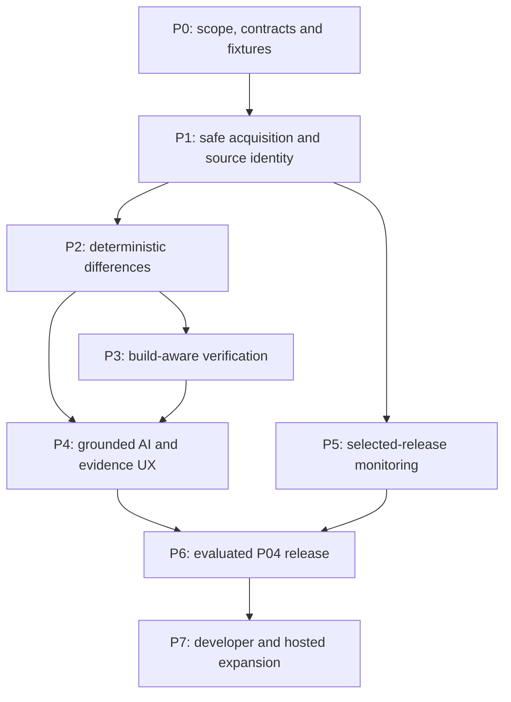

# Heurisko — proposed implementation roadmap

Date: 31 October 2026. **PROPOSED — NOT YET APPROVED.** This document recommends engineering work; it does not authorize implementation. No product repository or application has been created by this research.

The roadmap follows dependency and evidence needs, without imposing the event's 12-hour limit on the product vision. The scope is a source-to-published-artifact integrity investigation platform, with one analysis engine serving terminal, browser and automation. [Organizer requirement map](./_evidence/official-requirements.md); [proposed architecture](./HEURISKO_TECHNICAL_ARCHITECTURE.md).

## 1. Preserve the whole product while sequencing it

| Capability class | Included capabilities | Completion meaning |
|---|---|---|
| **Foundational / complete P04 obligations** | Registry artifact acquisition; corresponding source identification; provenance inspection/verification where available; raw comparison; generated/build transformation analysis; suspicious-change detection; evidence-backed assessment; **selected-package release monitoring**. | One supported ecosystem can satisfy the organizer's npm **or** PyPI wording. Each delivered path must expose uncertainty and limitations. Monitoring is not entirely deferred. |
| **Demonstration and credibility** | Genuine benign release, reproducible tampered local copy, uncertain case, live evidence drill-down, actual open-weight-model inference, real generated examples, reproducible CI. | A viewer sees the actual files, hashes, source identity and observed changes behind every statement. |
| **Developer enhancements** | Optional TUI, project/lockfile audit, upgrade comparison, SARIF mapping, saved policy, broader build recipes, performance profiling. | Each improves an existing workflow; it does not bypass engine controls or create separate verdict logic. |
| **Future platform** | Hosted search/investigations, durable multi-user watchlists, organization access, notifications, shared report service, broad ecosystem coverage. | Requires explicit operation/security/cost decisions, rather than being silently assumed by the web interface. |
| **Research-dependent** | General semantic equivalence of arbitrary builds; automatic recipes for unfamiliar toolchains; trustworthy explanation of heavily obfuscated/native artifacts. | Evaluate on held-out cases. Retain abstention if evidence cannot justify a reliable conclusion. |

“Complete” means declared capability support with honest residual uncertainty, not a promise to prove arbitrary packages benign. A first milestone does not remove later obligations from the roadmap.

## 2. Dependency graph

A static report viewer, source adapter and evaluation harness can progress concurrently after contracts are agreed. An unfamiliar build that cannot yet be reconstructed must remain investigable statically; that limitation must appear in the report.

## 3. Phase-by-phase engineering plan

### P0 — approve boundaries, contracts and acceptance evidence

**Delivers:** approved decision record, supported-input declaration, report schema, threat model, fixture manifest design and package/version selection procedure. This is an engineering phase after research approval, not something this dossier treats as done.

**Prerequisites:** founder decisions on shared engine/interfaces, ecosystem order, model/runtime constraints, deployment scope, license and operating boundaries. Resolve organizer API/test details where available; do not block local contract work on unavailable hidden tests.

**Work:** define immutable artifact identity, source candidate identity, provenance verification states, per-file correspondence, differences, findings, model interpretation, errors and resource limits. Separate transport-integrity failure from source/artifact mismatch. Declare local artifact input semantics for organizer tampered copies. Plan raw byte retention and bounded analysis of archives, source trees and model inputs.

**Complexity/risk:** medium engineering complexity, high downstream leverage. The main risk is a schema that collapses “source matched,” “attestation valid,” “rebuild matched” and “maliciousness” into one misleading status.

**Tests/evidence:** schema examples containing missing provenance, multiple source candidates, a matching rebuild with suspicious source behavior, and partial analysis. Validate that CLI and browser can represent each state without relabeling it “safe.” All example records at this stage are explicitly design fixtures, not actual generated analysis output.

**Acceptance:** each official P04 capability maps to an owner, phase and fixture; no unapproved hypothesis is marked confirmed; schema and engine boundary are agreed; threats and refusal/abstention cases are documented.

**Demonstrable outcome:** a design walkthrough of one complete investigation, clearly labeled as a proposal.

### P1 — safe artifact acquisition, provenance and source identity

**Delivers:** one working registry adapter; a common ecosystem-adapter interface; explicit local artifact analysis; validated download bytes; bounded archive inventory; repository/commit/subdirectory candidates; provenance verification through established tooling.

**Prerequisites:** P0 schema; adapter-specific registry semantics; chosen verification tooling; trusted acquisition policy. npm first is a proposed sequencing decision, not an assertion PyPI is impossible. A PyPI-first choice preserves the same contracts with wheel/sdist-specific handling.

**Work:** pin requested version and artifact filename; collect original metadata response and fetch time; verify registry-supplied digest where present; retain package identity and actual digest. Resolve candidate source revisions with their evidence rather than choosing a similarly named tag blindly. Record verified attestation identity/digest/source bindings separately from weaker repository fields. Fetch source safely without running hooks/build code. Enforce archive entry count, byte, nesting and path limits and no filesystem escapes.

**Complexity/risk:** high. Incorrect source association makes otherwise precise comparisons misleading. Acquisition may encounter moved tags, monorepos, missing provenance, registry throttling, incomplete artifacts and malicious archive structures.

**Tests/evidence:** digest mismatch; absent/invalid attestation; wrong tag with matching version name; monorepo package path; malformed URL; offline cache miss; duplicate/ambiguous archive paths; traversal/links/decompression limits; local tampered copy distinguished from canonical registry artifact.

**Acceptance:** every analysis binds to immutable downloaded bytes; unresolved source identity is reported explicitly; bad archives cannot escape the job workspace; no package lifecycle script or repository hook executes. Official digest mismatch must not be silently overwritten to force a successful comparison.

**Demonstrable outcome:** inspect a real release and show where each artifact/source identity came from, including a deliberately incomplete association case.

### P2 — deterministic comparison and useful evidence reports

**Delivers:** per-file inventories and hashes; correspondence candidates; manifest/script changes; textual/binary differences; baseline static security observations; JSON report and a readable CLI rendering.

**Prerequisites:** immutable inputs and source candidates from P1. Parsers must be treated as untrusted-input processing and bounded accordingly.

**Work:** preserve raw comparison as the authority. Add separately labeled normalized views and transformation candidates. Make archive packaging omissions visible without classifying every omitted repository test as suspicious. Highlight lifecycle-script additions, executable entry changes and unexplained executable files. Summarize analyzed, skipped and unsupported bytes/files. Model-free output remains useful and complete about what it did.

**Complexity/risk:** high. Minified bundles, native files and many-to-one compilation defeat naive path matching; normalization can erase important evidence. A “dist” directory name or a source map is a clue, not proof of legitimacy.

**Tests/evidence:** exact unchanged source files; packaging exclusions; timestamp-only differences; manifest mutation; binary/native artifact; multiple source files to one generated file; partially unsupported parser input; deterministic output comparison with clocks/run IDs excluded from the semantic comparison.

**Acceptance:** every finding points to existing evidence; all compared file changes have disposition or unresolved status; normalized equality never becomes an unqualified raw equality; CLI exits and structured report states distinguish analysis failure, policy failure and successful incomplete investigation according to the agreed contract.

**Demonstrable outcome:** genuine source/artifact comparison in the terminal, with file-level evidence that can be independently checked.

### P3 — build-aware explanation and isolated verification

**Delivers:** declared build transformations, rebuild evidence integration, supported safe build recipes and a route for unresolved build differences. Reuse independent evidence such as OSS Rebuild when its exact artifact/source scope matches; do not treat “a result exists” as verified coverage of the requested bytes.

**Prerequisites:** P2 raw evidence; trusted recipe representation; isolated worker design; pinned build tools/dependencies and sandbox policy. Running untrusted code locally without an isolation boundary is not an acceptable shortcut.

**Work:** classify explanation strength: exact correspondence, reproduced transformation, supported but unreproduced explanation, unexplained difference. Preserve raw rebuild output and normalized comparisons as distinct checks. Separate acquisition of declared build dependencies from the restricted execution phase. Record recipe/toolchain/network policy and dependency inputs. Reject or mark incomplete unsupported builds rather than automatically granting more host/network privileges.

**Complexity/risk:** very high. Reproducibility can fail from environment drift, unavailable dependencies, nondeterministic generators or malicious build logic. Exact rebuild matching establishes a relationship under recorded assumptions; it does not establish benign source code.

**Tests/evidence:** benign reproducible transformation; benign nondeterministic metadata; post-source mutation in distributed output; changed build dependency; missing toolchain; timeout/resource exhaustion; attempted network access or filesystem escape. Validate host isolation separately from product detection quality.

**Acceptance:** at least one genuine supported build transformation has independently reproducible evidence; mismatches retain relevant bytes and recipe data; no unsupported transformation is auto-dismissed as expected. Isolation and cleanup tests pass before executing hostile build cases.

**Demonstrable outcome:** show why a real compiled/generated file corresponds to the source, then why a prepared changed artifact does not reproduce under the same recorded conditions.

### P4 — useful open-weight AI and shared investigation interfaces

**Delivers:** integrated open-weight inference; evidence-bound model explanation; browser evidence explorer using the same report contract; documentation/installation; optional TUI after CLI value is established.

**Prerequisites:** deterministic observations from P2; build evidence from P3 where available; exact model/runtime/license selection; measured test-machine feasibility. P4 UX can start earlier against schema fixtures, but real example output must be generated by the real engine.

**Work:** supply bounded evidence snippets with stable IDs to the model; require structured interpretations that cite those IDs; reject invented paths/claims; keep model interpretations separate from deterministic conclusions. Record model artifact, quantization/runtime, prompt/template version and inference settings. Support model-unavailable and invalid-output states. Build web screens for source identity, file correspondence, differences, explanation evidence and limitations; use progressive disclosure and virtualization for large results. The web can read local/exported reports without requiring a hosted analysis account.

**Complexity/risk:** high. Structured syntax does not ensure factual correctness; code comments/metadata can contain prompt injection; model downloads, memory use and context size can block inference on evaluation machines.

**Tests/evidence:** evidence-reference validation; prompt-injection cases; invented filenames; model timeout; no-model baseline versus model-assisted explanation on held-out differences; the same report rendered consistently in CLI and browser; accessibility/large-diff navigation.

**Acceptance:** actual inference runs without a closed API/key dependency; the claimed model performs meaningful measured work; unsupported explanations abstain; no model output upgrades source/provenance/rebuild verification status. Quantitative improvement and latency are reported only after measurement; if improvement is absent, revise the AI task rather than claim success.

**Demonstrable outcome:** explain a difficult real difference with clickable evidence, then show what remains unresolved when the model lacks adequate evidence.

### P5 — selected-package new-release monitoring

**Delivers:** basic monitoring of explicit supported package/version streams, durable cursor/checkpoint, deduplicated analysis jobs and visible failures. This phase satisfies O04-08; it is part of complete P04, even though advanced hosted monitoring remains later.

**Prerequisites:** acquisition/version identity from P1; useful engine report from P2–P4; scheduler host explicitly selected. A laptop process, explicit cron/CI schedule or hosted worker can run the same monitor contract; all are proposals pending operational selection.

**Work:** resolve new releases to immutable artifacts; record discovery time and selected version/channel policy; deduplicate by artifact identity; resume after restart; bound retries/concurrency and honor throttling. Handle release deletion/yanking and changed metadata without inventing a new immutable release. Store separate discovery and analysis outcomes. Include a deterministic fake registry/clock for CI and a public-data demonstration where permitted.

**Complexity/risk:** medium-to-high. Mutable tags, pre-releases, registry outages and retries can cause missed or duplicate work. A CLI `watch` only monitors while its process runs; the UX must state that clearly.

**Tests/evidence:** successive release discovery; duplicate response; restart before/after job commit; retry after rate limit; failed analysis; no new release; moved tag; policy excludes pre-release. A missed poll must not be reported as a successful check.

**Acceptance:** a simulated newly published supported artifact is discovered once, analyzed, and retained across restart; failures remain visible and retryable; exact monitoring scope/cadence/host is documented. This does not claim uninterrupted monitoring without a running scheduler.

**Demonstrable outcome:** a controlled registry replay introduces an unseen release and triggers a genuine new analysis; replay data is labeled as simulated, analysis output is real.

### P6 — evaluated release, actual examples and presentation

**Delivers:** an evaluated complete P04 vertical slice, documented support matrix, real examples, green CI, reproducible setup and presentation evidence.

**Prerequisites:** core capabilities P1–P5; validation corpus and metrics from [verification strategy](./HEURISKO_VERIFICATION_STRATEGY.md); all required repository files and PR workflow.

**Work:** evaluate held-out benign/modified/uncertain releases; separate detector findings, explanation correctness, source-match correctness, coverage/abstention and runtime. Preserve artifact hashes/source commits/corpus manifests. Generate examples from the actual version being submitted; rerun clean installation and CI. Check all members can explain core logic. Rehearse the eight-minute demo and four-minute Q&A using real output.

**Complexity/risk:** high integration complexity. Handpicked samples can hide ordinary build false alarms; copied fixture outputs can become stale; network-dependent demos can fail.

**Tests/evidence:** clean setup; no-secret/no-closed-inference check; full meaningful evaluation; CI on final commit; selected monitoring case; offline report replay with capture time shown; live tampered input not tied to hardcoded package names.

**Acceptance:** all official capabilities have generated evidence or an explicit documented unsupported boundary; build/model failures do not become favorable verdicts; metrics include denominators/uncertainty and all abstentions; final CI passes; examples contain actual input/output; claims match implemented behavior. Do not label the full event task complete if required monitoring or meaningful model use is still absent.

**Demonstrable outcome:** trustworthy live investigation covering benign transformation, introduced suspicious change and honest uncertainty. Evidence of quality matters more than an impressive dashboard count.

### P7 — developer and hosted-platform expansion

**Delivers:** project/lockfile audits and upgrades, second ecosystem adapter, optional TUI, hosted investigations/search/reports, durable notifications and collaboration where justified.

**Prerequisites:** P6 quality baseline plus explicit founder choices on accounts, retention, quotas, infrastructure, licensing and abuse controls. Each addition reuses the core contracts rather than creating a second engine.

**Work:** rank workflows by measured user value; support lockfile formats with frozen resolution semantics; analyze only changed artifact identities when appropriate; make report sharing opt-in; constrain public anonymous job submission; add retention/deletion and cache governance. Private dependencies are outside the event's public-data scope and require separate authorization and threat review before future support.

**Complexity/risk:** variable high. Transitive audits amplify missing-source rates and costs; public workers attract abuse; notifications introduce operational reliability obligations.

**Tests/evidence/acceptance:** second ecosystem passes the adapter conformance suite without redesigning common report semantics; lockfile audit reports unsupported entries; TUI improves navigation in observed tasks; hosted analysis enforces isolation/limits/access; retention/deletion behavior is tested. Do not add a new service merely to make the architecture appear sophisticated.

**Demonstrable outcome:** real dependency-upgrade review and shared investigation, with consistent evidence across interfaces.

## 4. Four-contributor workstreams

| Workstream | Initial ownership | Safe independent work | Integration dependency |
|---|---|---|---|
| A — Identity and acquisition | Registry/source/provenance adapters; content-addressed inputs | Metadata fixtures, source-candidate cases, verification wrappers | Publishes immutable inputs and candidate evidence to the agreed schema. |
| B — Comparison and build evidence | Inventories/diffs, correspondence, recipes, rebuild integration | Pure compare functions against fixture manifests; static findings | Consumes A inputs; supplies evidence IDs to C/D. |
| C — Developer experience and intelligence | CLI report rendering, web evidence explorer, docs, AI explanations; later TUI | UI schema fixtures labeled as such; model evidence-validation contract | Must render engine statuses without its own verdict logic; model depends on B evidence. |
| D — Verification and operations | Corpus/ground truth, CI, isolation, monitoring, release quality | Malformed-archive tests, scheduler replay, evaluation harness | Controls test separation; monitoring consumes A and completed reports; sandbox supports B. |

All contributors review the report schema and threat boundary. Each area has a secondary reviewer. Ownership is not a knowledge silo: the event allows judges to question any member about any part of the implementation. Do not assign the fourth person solely presentation slides while engineering risks remain unowned. (O-DOCX §6; O-PDF p18.)

## 5. Integration sequence and GitHub workflow

1. After implementation approval, create the new public empty repository. The **only first-commit file is HACKATHON.md**, with actual team/problem/models/reasons. Do not initialize it with README, LICENSE or a template. (O-DOCX §4.1.)
2. First PR adds license, README, mandatory PR template, installation/test CI and schema/conformance fixtures. Its CI must run successfully; subsequent PRs keep it useful. Product models and coding assistants are separately declared. (O-DOCX §§4.2–5.)
3. Merge the smallest honest vertical slice: immutable local artifact + pinned source → raw report → CLI. Add a real generated example as soon as the engine exists, labeling limits.
4. Integrate registry acquisition/source/provenance, then deterministic suspicious-change findings. In parallel, develop web rendering against the schema and evaluation against public-data fixtures.
5. Integrate build-aware evidence, actual model inference and monitored-release discovery. Keep each feature behind explicit capability flags while incomplete; do not count flags/stubs as functionality.
6. Merge evaluated examples, clean installation documentation and final support/limitations. Ensure final commit CI passes and all relevant PRs follow the mandatory template. Freeze at the organizer's submitted version, not an unreviewed local branch.

Repository link and init commit are due 31 October 2026 20:30; final merge/push and OrganizerHQ submission are due 1 November 2026 06:30, event-local India time inferred from the Sonipat venue. These deadlines are recorded event facts, not engineering duration estimates. O-PDF pp10–11,16,20–21; O-DOCX §4.1. Visual review confirmed literal `00` placeholders on the main scoring slide, so the full weights remain unavailable; see the requirement map rather than an invented rubric.

## 6. Highest-priority engineering risks and decision triggers

| Risk | Early evidence needed | If the evidence fails |
|---|---|---|
| Wrong source revision or monorepo directory | Known-source corpus and conflicting metadata cases | Keep candidates and abstain on correspondence; improve resolver, not detector confidence. |
| Ordinary generated artifacts trigger excessive alarms | Held-out real releases across toolchains | Add general transformation evidence/rebuild support; avoid package-name exception lists. |
| Rebuilds require unsafe privileges | Isolation/egress/host-escape tests; recipe capability declaration | Disable execution for that case and retain static analysis; do not weaken the host boundary. |
| Model adds fluent unsupported claims | Grounded-explanation metrics and no-model ablation | Constrain/reassign its task or change candidate model; retain deterministic evidence. |
| Native/minified/obfuscated artifacts exceed analysis capability | Coverage report and diverse held-out cases | Mark unsupported/unresolved scope; do not infer benignity from a parser failure. |
| Monitoring loses/duplicates releases | Durable scheduler replay and restart cases | Correct checkpoints/idempotency before claiming O04-08 delivered. |
| Hosted costs and abuse exceed sustainable operation | Job-level CPU/bytes/model usage measurements and quotas | Keep local execution/shareable reports; require operational decisions before public execution. |
| Existing tools cover more of the proposed novelty | Direct OSS Rebuild/other-tool comparison | Integrate mature verification; differentiate in evidence correlation and investigation UX only where demonstrated. |

## 7. Approval and evidence gates

Before engineering starts, settle the proposed decisions listed in [founder decisions](./HEURISKO_FOUNDER_DECISIONS.md). Prioritize the engine/interface boundary, ecosystem sequence, trust/verification semantics, model execution environment, isolation strategy and local-versus-hosted operation. These decisions need not settle every future feature.

Implementation is ready to start when those boundaries and acceptance evidence are agreed. It is ready to claim complete P04 when all eight organizer capabilities, meaningful actual model use and required repository evidence are demonstrated. It is ready for broad security claims only to the extent measured evidence supports those precise claims; arbitrary “safe package” certification remains outside the proposed product.
