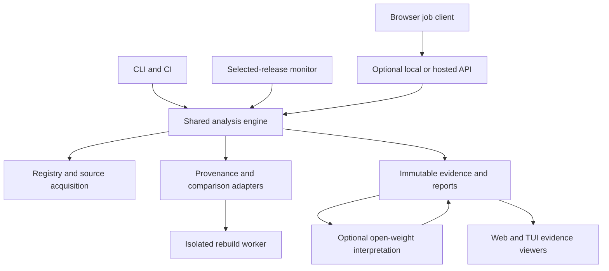

# Heurisko — Technical Architecture

Research baseline: 31 October 2026. Status: **PROPOSED — NOT YET APPROVED**. This document recommends a design; it does not report an implemented system or authorize engineering work.

## 1. Architectural recommendation

Use one local-first, versioned analysis engine with interchangeable registry and evidence adapters. The CLI owns analysis invocation and automation. The web interface and optional TUI inspect the same immutable evidence reports. A basic release monitor invokes the engine for new artifacts. Rebuild execution belongs behind a separate isolation boundary; model inference belongs behind an evidence-constrained interpretation boundary.

The proposed implementation is a TypeScript monorepo: Node CLI and engine, React/TypeScript web viewer, optional Ink report reader, JSON Schema report contracts, and optional external verifier/rebuild executables. The language choice is an engineering recommendation based on shared types and the team's React/TypeScript experience, not a claim that TypeScript is intrinsically safer or faster. Pin supported released runtime/library versions during an implementation spike; no compatibility matrix has been executed during research.

Support npm first while designing and testing the adapter contract against PyPI distributions immediately. The official problem permits npm **or** PyPI; completing both is the proposed product direction, not an organizer mandate. Release monitoring is an organizer requirement and remains in the complete core scope. A hosted dashboard is a later deployment option.

## 2. Alternatives evaluated

| Alternative | Advantages | Costs and failure modes | Recommendation / confidence |
|---|---|---|---|
| TypeScript shared engine, Node CLI, React web | Shared contracts, strong fit with JavaScript packages and existing team skills, easy report rendering | Node runtime distribution, separate Python/Go tools where needed, archive security still requires explicit controls | Proposed default; medium-high confidence pending adapter and packaging spike |
| Go engine + CLI/Bubble Tea; React viewer over JSON | Single executable, explicit concurrency, strong terminal ecosystem | Cross-language contracts, AST/transpilation integrations are separate adapters, more unfamiliar code for this team | Strong alternative if binary distribution wins; medium confidence |
| Rust engine + Ratatui; React viewer | Native distribution, strong memory safety for owned code, good terminal libraries | Higher integration/learning cost; parser correctness and untrusted build execution still require containment | Reconsider for demonstrated hot paths; medium confidence |
| Python engine + Textual | Natural PyPI/attestation integration, rapid analysis scripting | Multi-runtime JS analysis, packaging and runtime environment management | Credible PyPI-first alternative; medium confidence |
| Hosted-only analysis API | Central caches, monitors and heavy workers | Network/account dependency, operational cost, disclosure of submitted inputs, outage impact | Reject as prerequisite; retain optional service |
| Fully in-browser analyzer | Easy report access and local file selection | Large archives, repository retrieval, native verifiers and rebuild isolation do not fit one browser execution environment | Use browser as viewer and job client, not universal worker |
| Independent CLI and web analyzers | Each interface can evolve independently | Duplicated trust rules and contradictory conclusions | Reject |

The [product definition](HEURISKO_PRODUCT_DEFINITION.md) and [tooling analysis](HEURISKO_TOOLING_AND_REUSE.md) examine concrete language/TUI alternatives. These are selection tradeoffs, not measured benchmarks.

**Repository structure:** prefer a monorepo because schema, engine, CLI and viewer changes can be reviewed atomically and tested against one conformance suite. Separate repositories allow independent release permissions and language/tooling lifecycles, but require explicit schema-version coordination and cross-repository integration tests. Extract a worker/verifier adapter only if ownership or independent release needs justify it; a subprocess boundary does not by itself require another repository.

**Deployment:** local/persistent processes suit long investigations and a running monitor. A serverless control plane can authenticate, queue jobs and serve reports, but arbitrary package parsing and rebuilding must be evaluated against the provider's duration, memory, filesystem and isolation constraints. Prefer persistent or job-based isolated workers for heavy tasks. No named hosting provider or its current numeric limits has been validated, so the choice is architectural rather than a deployment commitment.

## 3. Components and trust boundaries

The graph expresses responsibilities, not a requirement for eleven services. The core, acquisition, comparison, store and CLI can run as one process with isolated parsing workers. Only untrusted builds require a materially stronger execution boundary. Hosted operation can begin with one control-plane service plus separately isolated job workers; a microservice fleet is unjustified.

| Component | Owns | Must not do |
|---|---|---|
| Registry adapter | Name normalization, exact release and distribution discovery, digests, candidate repository metadata, release listing | Declare metadata truthful or execute install/build hooks |
| Source resolver | Candidate evidence, immutable commit selection, monorepo subdirectory, contradictions | Substitute current default branch or equate a version-named tag with proof |
| Acquisition layer | Bounded downloads, request provenance, digest checks, cached immutable objects | Trust arbitrary redirect destinations or metadata URLs without validation |
| Archive/parser workers | Bounded inventories, content records, manifests, static syntax parsing | Execute package code, follow links outside analysis roots, silently drop unparsed files |
| Comparison pipeline | Raw comparisons, declared normalizations, structural evidence, build-output correspondence | Treat a filename, AST resemblance or source map as benignness proof |
| Provenance adapter | Cryptographic verification, predicate interpretation, policy evaluation, retained verifier output | Treat JSON decoding or a badge as successful verification |
| Rebuild adapter | Reuse attestation providers or submit declared build plans to isolated workers | Run inferred shell commands on a developer host |
| Model adapter | Explain selected evidence, propose hypotheses with evidence IDs, abstain | Select source trust, alter observed hashes or issue authoritative verdicts |
| Policy evaluator | Explicit CI decisions over evidence/status and coverage requirements | Convert missing evidence into a passing security claim |
| Report renderer | CLI/TUI/browser representations, escaping, stable deep links | Recompute independent security decisions |
| Monitor | Durable release/artifact checkpoints, retries, job deduplication, status visibility | Claim continuous monitoring while stopped or mark failed analysis complete |

## 4. Analysis data flow

1. **Resolve input.** Parse an explicit ecosystem/name/version and, for PyPI, filename or selection policy. Resolve floating tags only at intake and retain the resulting immutable target. Local archives are explicitly labeled local inputs.
2. **Snapshot registry evidence.** Save relevant metadata, retrieval time, origin, response digest and expected artifact digest. For wheels, create distinct subjects per filename/platform; one wheel cannot represent the whole version.
3. **Acquire bytes directly.** Stream the selected registry tarball, wheel or sdist under download/time limits. Compare bytes against the registry's advertised digest and retain both observed and expected values. No install step is needed to inspect an archive.
4. **Inventory safely.** Record original and canonical paths, file types, raw content hashes and byte counts. Reject ambiguous/escaping entries. Excluded, unreadable, oversized and unsupported objects remain counted in coverage.
5. **Resolve source.** Prefer artifact-bound, verified and policy-accepted source/build evidence where available; otherwise corroborate independent metadata and release candidates. Save all rejected/ambiguous candidates and reasons. Fetch immutable source and identify the package's monorepo root.
6. **Compare in layers.** First raw inventories/content, then narrowly declared packaging transformations, then static structural/mapping evidence, then optional isolated rebuilding. Each layer adds evidence; it never overwrites raw mismatches.
7. **Verify external evidence.** Evaluate attestations and existing rebuild results against the same artifact subject. Retain tool version, trust root, expected identity, predicate type and result; do not assume all evidence providers use the same signature scheme.
8. **Produce findings.** Link unexpected scripts, executable additions and unexplained residuals to exact bytes/locations and the source candidate used. Separate an observed modification from an inferred malicious purpose.
9. **Interpret with an open model.** Supply bounded evidence excerpts with inert delimiters and IDs. Validate IDs and quotations after inference. Unverifiable claims become rejected annotations, not findings.
10. **Commit a report.** Atomically write the content-addressed evidence manifest and immutable analysis report. Render the same report in every interface. Reanalysis creates a new report linked to the old one.

Registry signatures establish identity/integrity under their trust model, not independent source equivalence. npm itself states that provenance does not guarantee absence of malicious code. PyPI exposes distribution-specific provenance links, so evidence must be bound to the particular file. Sources: [npm provenance](https://docs.npmjs.com/generating-provenance-statements/), [PyPA Simple API](https://packaging.python.org/en/latest/specifications/simple-repository-api/), [index-hosted attestations](https://packaging.python.org/en/latest/specifications/index-hosted-attestations/).

## 5. Source relationship policy

Source resolution must preserve both the evidence strength and what the evidence actually asserts.

| Evidence | Possible use | Required limitation |
|---|---|---|
| Verified source/build provenance binding subject digest to repository and commit, accepted expected builder/source policy | Strong relationship evidence | Trust in builder/identity and predicate remains; not independent rebuild equivalence |
| Verified publish attestation naming workflow/publisher | Establish publisher evidence | Do not infer a build/source relationship absent an applicable predicate |
| Registry `gitHead`, repository field, release tag and matching package manifest | Corroborated candidate selection | Fields can be mistaken or adversary controlled; retain contradictions |
| Tag name equals package version | Candidate generator | Mutable or misleading tag is not proof |
| File matches from a broad history search | Candidate corroboration | Similarity is not unique identity or authorization |
| Current default branch | Context only | Never the automatic authoritative release baseline |

For monorepos, record the repository commit separately from the package subdirectory and build workspace. Build inputs may include sibling packages, lockfiles, submodules, Git LFS objects and generated assets. If an input cannot be acquired, record the scope gap; do not silently treat an incomplete source tree as the whole build context. The resolver is allowed to return ambiguous/missing and continue an artifact-only static investigation with reduced claims.

## 6. Comparison and explanation ladder

**Raw evidence:** archive digest, extracted file content hashes, path inventory, file modes where meaningful, manifest and script changes. Archive-byte mismatch and extracted-content mismatch are separate observations.

**Packaging explanations:** removal of tests/docs can be consistent with declared package inclusion rules. A rule in a manifest explains an intention, not proof that every exclusion is authorized. Generated banners, timestamps and line endings require a named/versioned transform; preserve their original differences.

**Structural analysis:** parse JS/TS or Python where supported; classify generated wrappers, imports, lifecycle entries and added executable structures. AST normalization cannot establish arbitrary semantic equivalence and must not remove behavior-bearing literals, dynamic code or script additions.

**Mapping evidence:** source maps and compiler metadata help locate origins but are themselves untrusted artifact content. Validate references against acquired source, record mapped/unmapped executable regions, and label correspondence rather than proof.

**Rebuilding:** compare a declared source, toolchain and dependency set in an isolated environment against the exact registry subject. Report byte match, extracted-content match and normalization-qualified match distinctly. A mismatch can arise from the environment or nondeterminism; a match can reproduce malicious source.

**Residual triage:** every unexplained executable residual remains visible. The model may suggest a transformation or review priority but cannot discharge it. No expanding package-name allowlist should turn a residual into an explanation.

[OSS Rebuild](https://github.com/google/oss-rebuild) already derives and evaluates rebuilds for npm, PyPI and crates.io and publishes attestations for covered packages. It should be an optional evidence provider. Its current CLI's documented KMS authentication requirement means that anonymous availability of data must not be confused with locally verified signatures. See [tooling analysis](HEURISKO_TOOLING_AND_REUSE.md).

## 7. Canonical report contracts

The following is a proposed schema design, not sample output from an executed analysis. Use JSON Schema as the public, language-neutral contract and generate or validate TypeScript types from it. Separate schema version from engine, rule and policy versions.

| Record | Required fields / invariant |
|---|---|
| `ArtifactSubject` | ecosystem, normalized name, version, distribution filename, platform tags when relevant, origin, expected digest(s), observed digest(s), retrieved time; `local-input` cannot inherit registry authenticity |
| `SourceCandidate` | canonical repository, immutable commit if known, subdirectory, evidence IDs, relationship state, contradictory evidence and selection reason |
| `EvidenceObject` | stable ID, kind, origin, byte digest, storage reference, acquisition/tool metadata, declared scope and limitations |
| `FileRecord` | artifact/source side, canonical path plus original archive path, content digest, type, size, parser result, executable classification and skipped reason |
| `ComparisonRun` | method, tool/version, inputs/digests, transform/version, raw differences, output differences, ignored dimensions, elapsed time and completion state |
| `ProvenanceResult` | subject digest, signature status, predicate kind, asserted relationship, expected identity, observed identity, trust-root version, policy acceptance, verifier/version, reason |
| `Finding` | stable ID, category, severity, evidence confidence, locations, evidence IDs, reason, limitations and suggested review action |
| `Interpretation` | model/runtime/weights digest, prompt/template version, evidence IDs, supported explanation, hypotheses, uncertainty and rejected claims |
| `AnalysisReport` | schema version, engine/rule/policy versions, report ID, scope, all five status dimensions, coverage, stage outcomes, evidence manifest digest, findings, interpretations and prior-report link |
| `MonitorState` | selected package, last successful metadata snapshot, known artifact identities, pending/retry jobs, last analysis outcome, next check, failures and running/stopped state |

Canonical dimension values:

- Artifact identity: `registry-digest-match`, `local-input`, `conflict`, `unknown`.
- Source identity: `attested`, `corroborated`, `candidate`, `ambiguous`, `missing`.
- Provenance: `verified`, `invalid`, `absent`, `unsupported`, `not-checked`; additionally preserve independent `policyAccepted` and reasons.
- Comparison summary: `byte-identical`, `normalized-equivalent`, `rebuild-matched`, `partially-explained`, `unexplained`, `not-comparable`; individual method runs remain authoritative about which objects/dimensions matched.
- Completeness: `complete-for-declared-scope`, `partial`, `failed`.

`attested` is permitted only when verified, policy-accepted evidence actually binds the exact subject to the claimed repository/commit. A publish-only assertion does not qualify. `complete-for-declared-scope` can contain unresolved findings; it describes processing coverage rather than security. Severity describes potential impact; confidence describes evidence strength. Neither is a safety percentage. Rebuild state, model availability and per-stage failure details are retained separately.

## 8. Interfaces and integration boundaries

The proposed command hierarchy uses `analyze`, `inspect`, `compare`, `project`, `watch`, `report export`, and `serve --local`. Full workflows appear in the product definition. Automation gets one JSON object on stdout and progress on stderr. Use separate outcomes for completed analysis, policy rejection and incomplete/failed processing; exact numeric exit codes are a founder/API decision to freeze before external integration.

The core accepts a normalized request plus explicit budgets/trust policy and emits structured stage events and a final report. CLI and API clients share that request contract. Cancellation propagates to network requests, parser workers, model requests and rebuild jobs. Every stage returns success, unsupported, skipped, blocked, timeout or failure with reasons; partial evidence is retained.

The web viewer opens an exported report without an account. An optional local API binds loopback and requires a per-session token plus origin checks; do not expose unauthenticated privileged localhost job controls. A hosted API accepts public package identities, applies quotas and queues bounded jobs. Arbitrary URL uploads and private repositories are outside the event scope. Render source as escaped text; never execute package HTML, scripts, terminal escapes or active source-map links.

SARIF export maps actionable findings and locations; it cannot replace the full provenance/coverage report. Unsupported mappings remain in the JSON report rather than being silently omitted from security policy evaluation. Browser HTML exports are inert and self-contained where practical; source/evidence inclusion is explicit to control size and redistribution rights.

## 9. State, caching and reproducibility

Start with local SQLite metadata and content-addressed blobs on disk. Store reports and evidence separately from mutable monitor/job state. Hosted deployments can use relational metadata and object storage while keeping the same report format. Postgres, Redis, a global index and a distributed queue are not prerequisites.

Cache raw bytes by digest. Cache derived results by artifact digest + source commit/context + engine/rule/normalizer versions + policy/trust-root configuration + relevant toolchain inputs. A changed model produces a new interpretation record; it need not invalidate deterministic observations. A different verification time/trust-root snapshot may legitimately change verification results and must be recorded.

Report identity should hash a canonical evidence manifest and stable deterministic report payload. Exclude volatile timestamps, elapsed times and nondeterministic model prose from equivalence checks. Preserve those in run metadata rather than pretending the whole JSON is byte-identical across runs. Test interrupted writes and checkpoint recovery.

Offline mode can replay an already acquired evidence bundle and explain what was checked with cached trust material. It cannot discover new releases or promise current revocation/registry state. Distinguish replay of a prior report from a fresh verification run. Export verifier bundles and trust-policy metadata when redistribution permits; missing offline prerequisites result in `not-checked` or partial verification.

Retention duration, hosted quotas, per-job budgets, deletion timing, evidence publication policy and operating budget require founder decisions. Research supplies the required controls, not invented production defaults.

### Concurrency, backpressure and cost

Use separate bounded pools for metadata/download work, archive/parsing work, model inference and rebuild jobs. One queue depth or CPU count must not dictate all four: a large rebuild can exhaust disk while many small fetches exhaust an upstream rate allowance. Schedule with per-artifact byte/file/time budgets plus host-wide memory/disk ceilings. Stream inventories and page/virtualize file views; process only bounded relevant excerpts for AI while recording the selection and omitted executable content.

Backpressure should pause new intake rather than discard evidence. Deduplicate identical queued requests, allow cancellation, record budget exhaustion as partial analysis and expose queue/running state. Hosted mode needs per-user/IP quotas in addition to global limits; local mode needs explicit resource policy. On overload, preserve the last complete report and expose pending/stale state. Validate parser, network, model and rebuild cancellation separately.

Measure cost as metadata requests + artifact/source download bytes + retained evidence byte-days + parser/comparison CPU-seconds + rebuild CPU/memory-seconds + model tokens or accelerator-seconds + report egress. Benchmark a cold run, warm-cache run and release-monitor incremental run across small/large and compiled/interpreted packages. No cost, concurrency, latency or coverage target is adopted numerically before these measurements and founder approval. This model supports local-versus-hosted decisions without inventing a monthly price or assuming unlimited registry/API access.

## 10. Release monitoring

Implement a small persisted poller for selected packages, invoking the same engine. npm and PyPI have different version/distribution semantics; normalize them through `listReleaseArtifacts`, not a universal latest-version string. PyPI's Simple JSON API includes per-file identities and optional provenance, with version-aware parsing and normalized names. [Specification](https://packaging.python.org/en/latest/specifications/simple-repository-api/).

Monitor all newly observed selected artifact identities, including a newly uploaded wheel on an existing version. Track removals/yanks and digest conflicts as separate metadata events; a yanked file is not automatically malicious. Do not discard older unprocessed artifacts because a newer version appeared. Respect server cache validators when supplied, rate-limit responses and retry hints; use bounded retries/backoff with visible failure state. No undocumented global registry request quota is assumed.

At-least-once scheduling with an idempotent artifact+configuration job key is sufficient. Advance successful metadata checkpoints independently from analysis completion while durably retaining pending jobs; otherwise a crash can lose work. Record last successful fetch, last completed analysis, backlog and stale duration. Monitoring runs only while the local process/scheduler or hosted service is active. Notifications can begin as local/CI report events; outbound email, public comments and account management are separate decisions. Official rules prohibit automated comments/issues on real OSS projects.

## 11. Untrusted execution and operations

Static acquisition, hashing, inventories and parsing require no package execution. They still need bounded parser workers and strict archive handling. Builds require disposable Linux sandboxes with resource limits, no host mounts/credentials, restricted syscalls and controlled network acquisition. Container packaging alone is not the full threat boundary. A Linux gVisor worker or stronger microVM is a deployment candidate; macOS local execution requires a supported VM boundary and a verified operational setup. Do not silently fall back to host execution.

Separate dependency acquisition from the build phase: record fetched dependency digests in a controlled acquisition phase, then build offline where feasible. If a build needs network, fail with an explanation or use a separately approved restricted egress policy; record that scope. Worker-returned files/logs are untrusted and re-enter bounded parsing. [gVisor security model](https://gvisor.dev/docs/architecture_guide/security/) and the [verification strategy](HEURISKO_VERIFICATION_STRATEGY.md) cover limitations.

The AI interpreter has no tools, credentials or write access. Validation checks referenced evidence existence, exact quoted bytes and schema constraints. That does not prove semantic correctness; unsupported interpretations require human review. Deterministic results stay useful without inference, while the submitted event product must demonstrate meaningful real open-model use. Record actual model and runtime selection and a separately executed quality/latency benchmark before freezing them.

## 12. Decision gates and remaining uncertainty

| Gate | Evidence needed before implementation commitment | Outcome if unresolved |
|---|---|---|
| TS versus Go core | Tiny isolated adapter/packaging spike after approval; compare distribution and tool bridges | Retain language decision as proposed |
| Source identity policy | Fixtures with matching, conflicting and publish-only attestations | Ambiguous status and restricted claims |
| Normalization policy | Benign and injected paired cases preserving executable changes | Keep raw diff and abstain |
| Rebuild service | Demonstrated sandbox containment, artifact-specific comparisons, verifier authentication | Disable execution; explain static residuals |
| Model/runtime | Available hardware, genuine inference, evidence fidelity and model-off ablation | Keep deterministic reports and blocked AI requirement visible |
| Hosted deployment | Budget, quotas, retention/deletion, abuse controls and operator ownership | Local-first operation |
| General semantic equivalence | No general decidable proof exists for arbitrary programs; qualify any narrow method | Never claim universal equivalence or malware absence |

No package corpus was downloaded or rebuilt, no verifier was executed against a selected release, and no model or UI was implemented in this research phase. External documentation supports capability/design decisions; empirical detection rates, latency, coverage and operating cost remain unmeasured. Firecrawl was used for primary-source research until its account credit limit was reached; remaining material checks used available web retrieval. See source ledgers for coverage and failures.

## 13. Cross-document ownership

- Baseline: authoritative domain facts, official constraints and threat context.
- Product: personas, workflows, commands, screens and model role.
- This architecture: component boundaries, contracts, state and failure behavior.
- Tooling: reusable project evidence, licenses, maintenance and integration ranking.
- Verification: corpus, metrics, containment, demonstration and reviewer questions.
- Roadmap: dependency order, four workstreams and acceptance gates.
- Founder decisions: proposed decisions, supporting/opposing evidence and approval state.
- Executive brief: standalone recommendation and consequential limitations.

Where a proposed choice changes, update the decision register and all affected contracts together. Organizer requirements retain authority over product preferences.
